# Pokédex


An Android Pokédex with a daily **"Who's that Pokémon?"** game: guess the hidden Pokémon from its silhouette, keep your streak going, and browse every Pokémon from [PokeAPI](https://pokeapi.co/) with its stats, evolutions and type matchups. The Pokémon you catch are kept on the device.

<p align="center">
  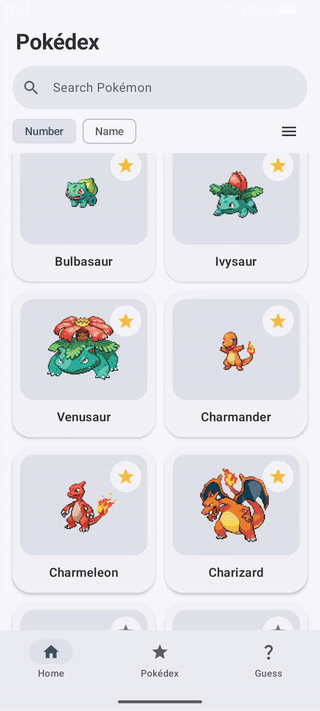
</p>

| Home | Type filter | Detail | Stats & matchups |
|:---:|:---:|:---:|:---:|
| 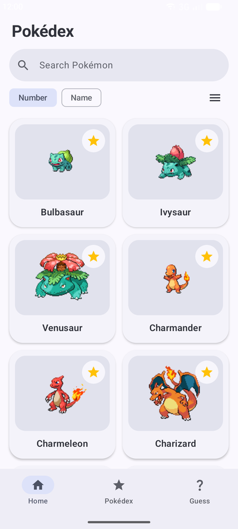 | 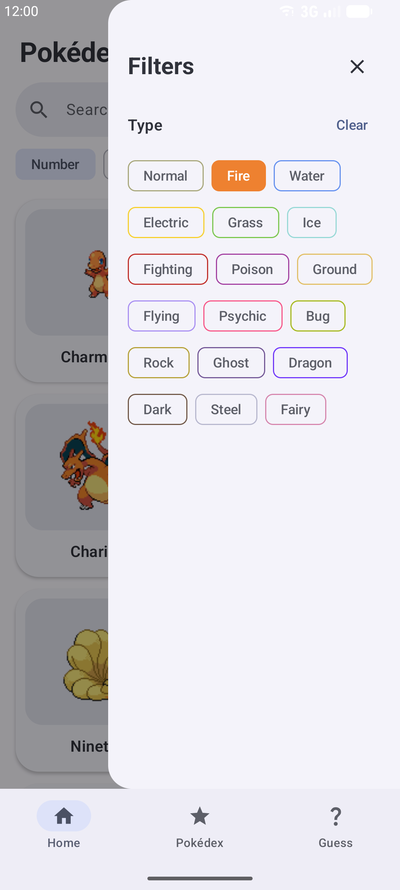 | 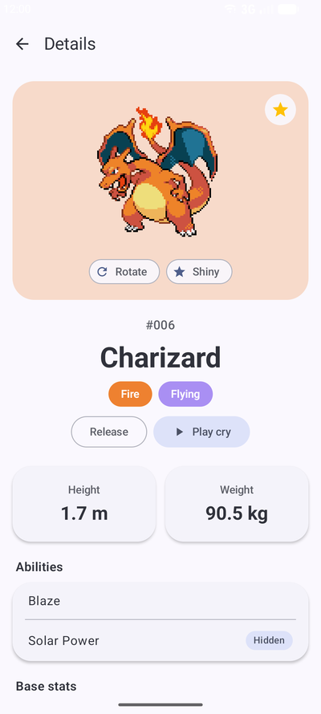 | 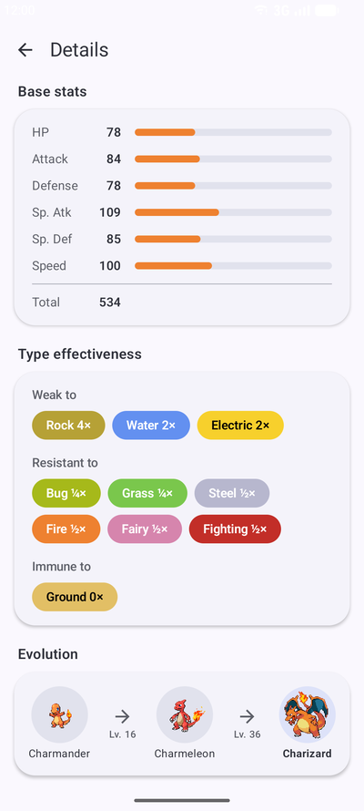 |
| **My Pokédex** | **Guess** | **Guess result** | |
| 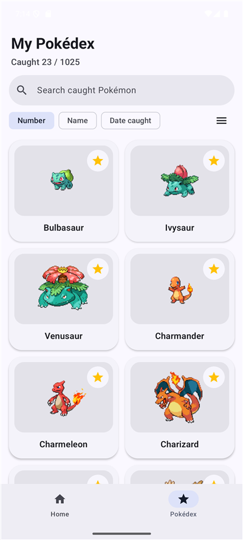 | 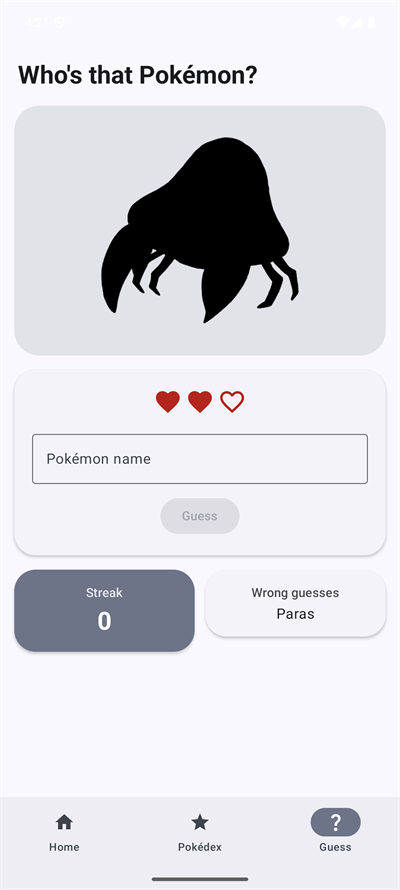 | 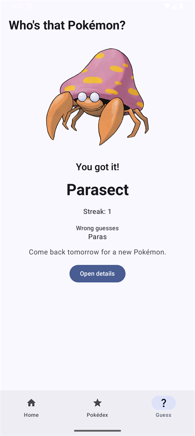 | |

## Features

- **Guess the daily Pokémon (US06):** one hidden Pokémon a day, shown as a silhouette. Three hearts to name it; a win raises the streak, a loss or a missed day resets it. The round and the streak are saved on the device.
- **Catch a Pokémon (US01):** tap the star on any card or "Catch" on the detail page. Caught Pokémon are saved on the device, and every screen updates at once.
- **Release a Pokémon (US02):** tap the star again, on any screen.
- **Browse all Pokémon (US03):** the full list, forms included, with search by name, sorting by number or name, and a filter by type (selected types combine with OR).
- **Inspect a Pokémon (US04):** sprites (front/back, shiny, female), its cry, height, weight, abilities, base stats, weaknesses and resistances computed from its types, and the evolution chain with its conditions. The sprite flies from the card you tapped into the detail page.
- **Review My Pokédex (US05):** the caught Pokémon with a "Caught x / 1025" counter, search, sorting by number, name or date caught, and the same type filter.

The user stories and their acceptance criteria are in [`docs/specification.md`](docs/specification.md).

## Tech stack & libraries

- **Minimum SDK 31** (Android 12), target SDK 37.
- **[Kotlin](https://kotlinlang.org/) 2.4.20 and [coroutines](https://kotlinlang.org/docs/coroutines-overview.html):** network and database calls are `suspend` functions started from `viewModelScope`, so they are cancelled when the screen goes away and never block the main thread.
- **[Jetpack Compose](https://developer.android.com/compose) with Material 3:** the whole UI is declarative, so each screen is a function of its state, with no XML layouts or view binding.
- **[Navigation Compose](https://developer.android.com/develop/ui/compose/navigation):** one activity with a bottom bar (Home, Pokédex, Guess) and the detail page. Its animated destinations drive the shared-element transition from a grid card to the detail page.
- **[ViewModel](https://developer.android.com/topic/libraries/architecture/viewmodel) + [LiveData](https://developer.android.com/topic/libraries/architecture/livedata):** each screen's state survives rotation, and Room's `LiveData` queries push caught-state changes to every screen without them talking to each other.
- **[Hilt](https://dagger.dev/hilt/):** dependency injection. Retrofit, Room and the clock come from Hilt modules, so the device tests swap in MockWebServer, an in-memory database and a fixed date without touching app code.
- **[Retrofit](https://square.github.io/retrofit/) 3 + OkHttp + Gson:** PokeAPI is declared as a Kotlin interface, and the JSON is parsed into DTOs that the repository maps to domain models.
- **[Room](https://developer.android.com/training/data-storage/room):** the caught list and the guess game's round and streak, with a real migration between schema versions. It is the single source of truth for everything the user creates.
- **[Coil](https://coil-kt.github.io/coil/) 3:** loads the sprites with a memory and a disk cache, so a sprite already shown appears at once.
- **Tests:** JUnit 4, [Turbine](https://github.com/cashapp/turbine), `kotlinx-coroutines-test`, Compose UI tests, [MockWebServer](https://github.com/square/okhttp/tree/master/mockwebserver), Hilt testing and Room's `MigrationTestHelper`.

## Architecture

The app follows Google's [Guide to app architecture](https://developer.android.com/topic/architecture): a **UI layer** and a **data layer**, plus the optional **domain layer** for the guess game's rules.

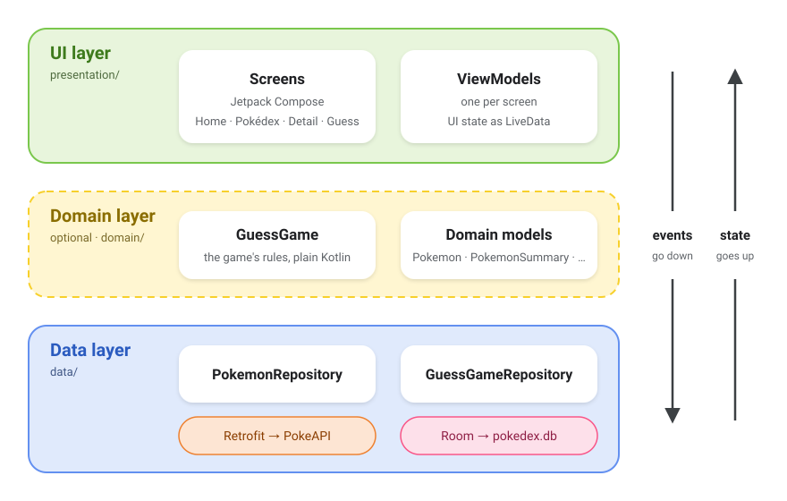

It applies the guide's four principles:

- **Separation of concerns.** Composables only draw the screen; ViewModels hold its state; repositories fetch and save data. No layer reaches past the one below it.
- **Drive the UI from data models.** Screens draw domain models (`Pokemon`, `PokemonSummary`, `DailyRound`), never PokeAPI's JSON or Room rows, so a change in the API or the schema stops at the data layer.
- **Single source of truth.** Room owns the caught list and the game's progress, and PokeAPI owns the Pokémon data. Nothing keeps a second copy that could disagree.
- **Unidirectional data flow.** Events go down (a tap calls the ViewModel, which calls a repository), and state comes back up as `LiveData`. A screen never changes its own state directly.

### UI layer

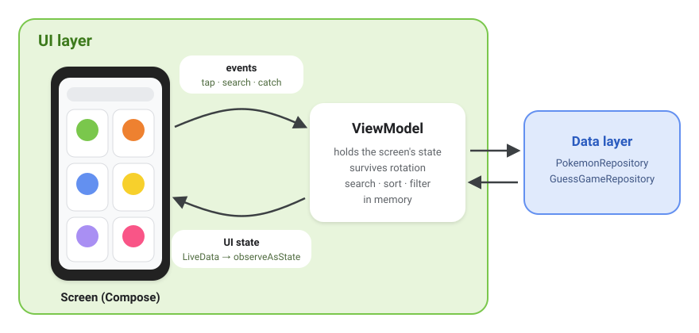

Each screen (Home, My Pokédex, Detail, Guess) is a composable with its own ViewModel. The ViewModel keeps the screen state as `LiveData`, so it survives rotation, and does search, sort and type filtering in memory on the loaded list. The screen reads that state with `observeAsState` and sends user actions back as plain function calls.

### Domain layer

The guide makes this layer optional, and the app uses it only where it pays off: `GuessGame` holds the daily game's rules (today's pick, name matching, hearts, streak) as a plain Kotlin class with no Android dependencies, tested on its own with fixed dates. The domain models live here too. There are no use-case classes: the other screens call the repository directly, because they would only pass the call through.

### Data layer

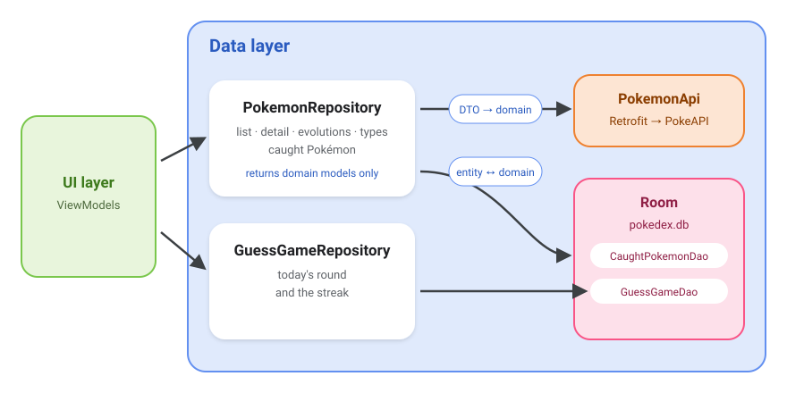

Two repositories are the only entry points to data. `PokemonRepository` reads PokeAPI through Retrofit and the caught list through Room; `GuessGameRepository` saves the game's round and streak in Room. Both map DTOs and entities to domain models, so PokeAPI's JSON shape never reaches the UI.

The app is **not offline-first**: the Pokémon list and details come from PokeAPI on every visit, and only what the user creates is stored. My Pokédex and the guess game's progress still work offline, because they come from Room.

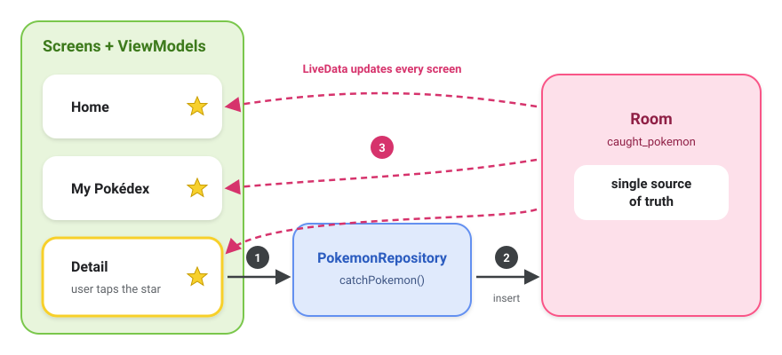

Because Room is the single source of truth for caught Pokémon, catching one on the detail page doesn't tell the other screens anything. Room's `LiveData` updates Home and My Pokédex on its own.

The full architecture (C4 context, containers and components, dynamic flows, deployment, Kruchten's 4+1 views, and how a Retrofit request and a Coil image load work) is in [`docs/architecture/`](docs/architecture/README.md), with every diagram explained.

## Testing

The tests are split into unit, JVM integration, device integration and system tests. No test calls the real PokeAPI: responses come from recorded fixtures, served by hand-written fakes on the JVM and by MockWebServer on a device, where Hilt also swaps in an in-memory database. The system tests drive the whole app through the Compose UI, one test class per use case in the specification. Layers, counts and commands are in [`docs/testing.md`](docs/testing.md).

## Build and run

1. Clone the repository and open it in an Android Studio version that supports AGP 9.4.
2. Run it on a device or emulator with Android 12 (API 31) or newer:

```bash
./gradlew installDebug
```

The app needs internet access to load data from PokeAPI.

## Credits

Pokémon data comes from [PokeAPI](https://pokeapi.co/), the sprites from [PokeAPI/sprites](https://github.com/PokeAPI/sprites) and the cries from [PokeAPI/cries](https://github.com/PokeAPI/cries). PokeAPI is free and needs no API key; please follow its [fair use policy](https://pokeapi.co/docs/v2#fairuse).

Pokémon and Pokémon character names are trademarks of Nintendo, Game Freak and The Pokémon Company. This is a personal project, not affiliated with them.
