# Pokédex architecture

Architecture of the Pokédex Android app, as PlantUML diagrams. Every diagram is shown below with a short explanation of what it shows and how to read it; the `.puml` link under each one is its source.

## How these docs are organized

The docs use two models because they answer different questions. **C4** zooms in step by step (the system, its containers, their components), and **Kruchten's 4+1** looks at the same app from one concern at a time (classes, runtime behaviour, code organization, deployment, use cases). A third group, the **guide** diagrams, explains how MVVM, Retrofit and Coil work in this app.

- [`inventory.md`](inventory.md) lists what the code contains (stack, packages, data sources, flows) and the decisions behind the design. The diagrams are drawn from it.
- Every diagram follows the same rules:
  - **One abstraction level per diagram:** one C4 level or one 4+1 view.
  - **No invented elements:** every element and relationship exists in the code or the build configuration.
  - **Planned items are kept apart from existing ones:** they appear only in `04-deployment-planned`, drawn dashed.
  - **Dead code is left out.**
  - **About 10 elements at most.** The component level has 21, so it is split into three parts: the UI layer, the data layer and the guess game.
  - **One shared style:** every diagram includes [`style.puml`](style.puml).
- The same name means the same element in every diagram.

Contents: [C4](#c4) · [4+1](#41-views) · [Guide](#guide) · [Illustrations](#illustrations) · [Known limitations](#known-limitations) · [Rendering](#rendering-the-diagrams)

## C4

Sources in [`c4/`](c4/). Boxes are people, systems, containers or components; arrows are labelled with what flows and the technology used.

### 1. System context

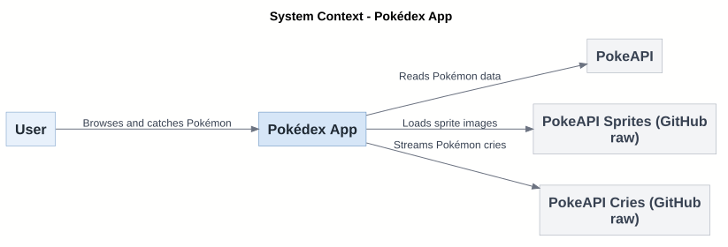

Source: [`01-context.puml`](c4/01-context.puml)

The widest view: one user, the app, and the three external systems it reads from. PokeAPI gives the Pokémon data as JSON. Sprites and cries are drawn as separate systems because they are served from the `PokeAPI/sprites` and `PokeAPI/cries` GitHub repositories on `raw.githubusercontent.com`, not from `pokeapi.co`. There is no backend of our own.

### 2. Containers

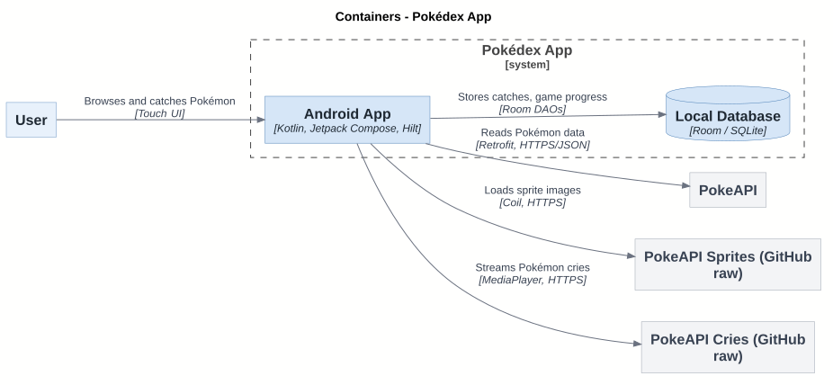

Source: [`02-containers.puml`](c4/02-containers.puml)

Opens the app box: the Android app itself and its local Room database (`pokedex.db`). The arrows name the library behind each connection: Retrofit for PokeAPI, Coil for sprites, `MediaPlayer` for cries, Room DAOs for the database. The database only holds what the user creates: caught Pokémon and the guess game's progress.

### 3. Components: UI layer

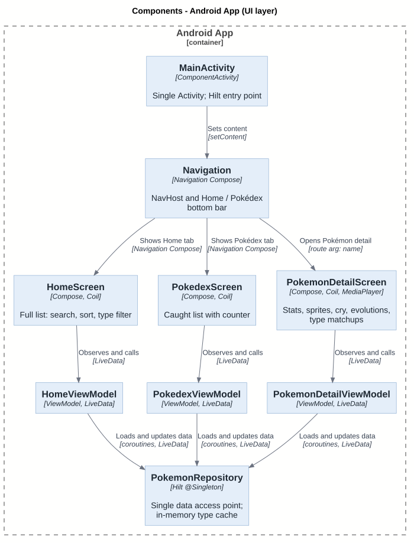

Source: [`03-components-android-app-ui.puml`](c4/03-components-android-app-ui.puml)

Part 1 of 3 of the component level. `MainActivity` sets `Navigation` as its content, which shows the three tabs (Home, Pokédex, Guess) and the detail page. Each screen has its own ViewModel, and every ViewModel goes through `PokemonRepository`. Shared composables (grid, search bar, filter panel) belong to the screens and are not drawn.

### 3. Components: data layer

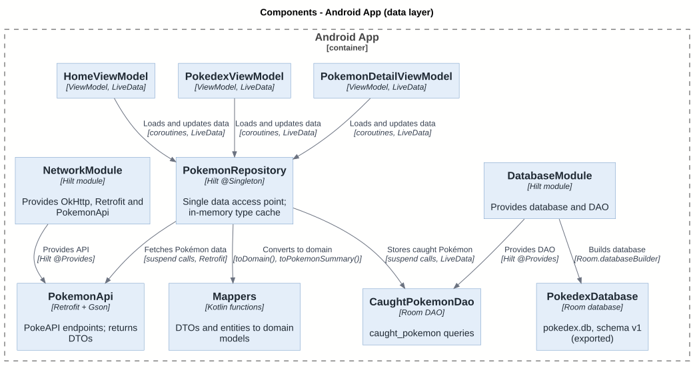

Source: [`03-components-android-app-data.puml`](c4/03-components-android-app-data.puml)

Part 2 of 3. `PokemonRepository` gets `PokemonApi` (Retrofit) and `CaughtPokemonDao` (Room) from Hilt modules, and converts their DTOs and entities with the mappers, so the ViewModels only ever see domain models. Because Hilt provides Retrofit and Room, the device tests can replace both with test modules.

### 3. Components: guess game

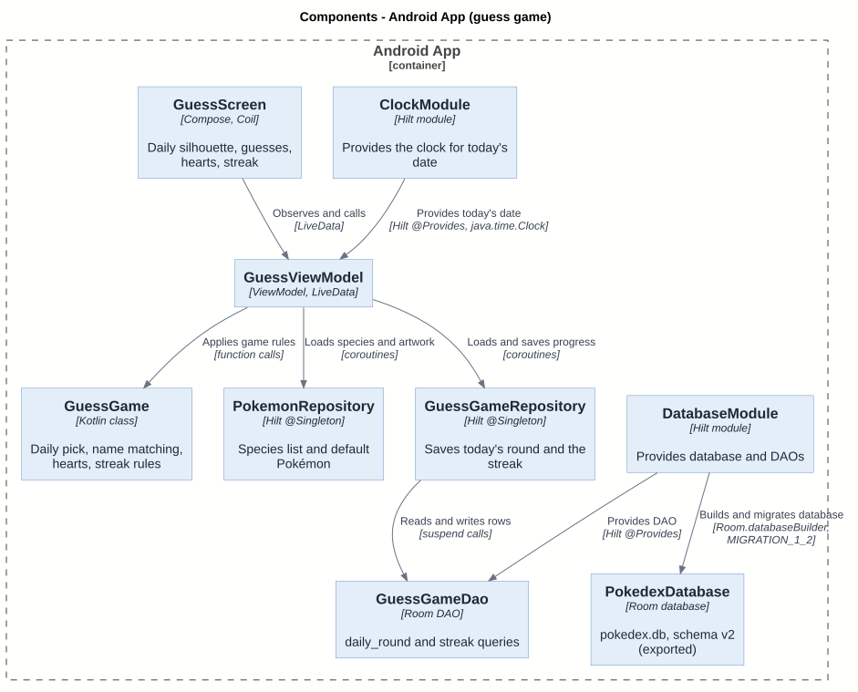

Source: [`03-components-android-app-guess.puml`](c4/03-components-android-app-guess.puml)

Part 3 of 3. `GuessViewModel` asks `GuessGame` (plain Kotlin) to apply the rules, gets today's date from the `Clock` that `ClockModule` provides, loads species and artwork through `PokemonRepository`, and saves the round and streak through `GuessGameRepository` in the `daily_round` and `streak` tables.

### Dynamic: browse and filter

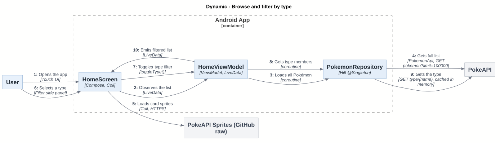

Source: [`dynamic-browse-and-filter.puml`](c4/dynamic-browse-and-filter.puml)

Read the numbers in order. One request loads the whole list; search and sort then run in `HomeViewModel` with no network call. Selecting a type fetches that type's members once (cached in the repository), and several selected types combine with OR.

### Dynamic: catch / release

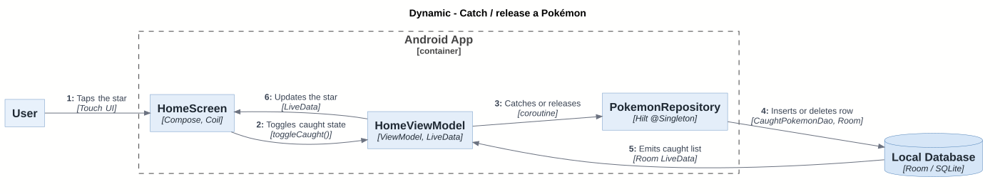

Source: [`dynamic-catch-release-pokemon.puml`](c4/dynamic-catch-release-pokemon.puml)

A tap on the star goes down to Room as an insert or delete (steps 1 to 4), and the change comes back up as Room `LiveData` (steps 5 and 6). The screen never sets the star itself; it only draws what the database says.

### Dynamic: open detail

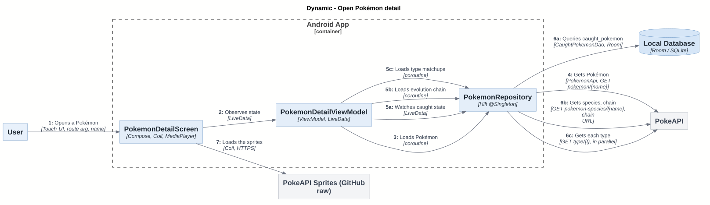

Source: [`dynamic-open-pokemon-detail.puml`](c4/dynamic-open-pokemon-detail.puml)

The detail page loads the Pokémon first, then starts three loads in parallel (steps 5a to 5c and 6a to 6c): caught state from Room, the evolution chain and the type matchups from PokeAPI. If one of the last two fails, that section stays hidden instead of failing the page.

### Deployment

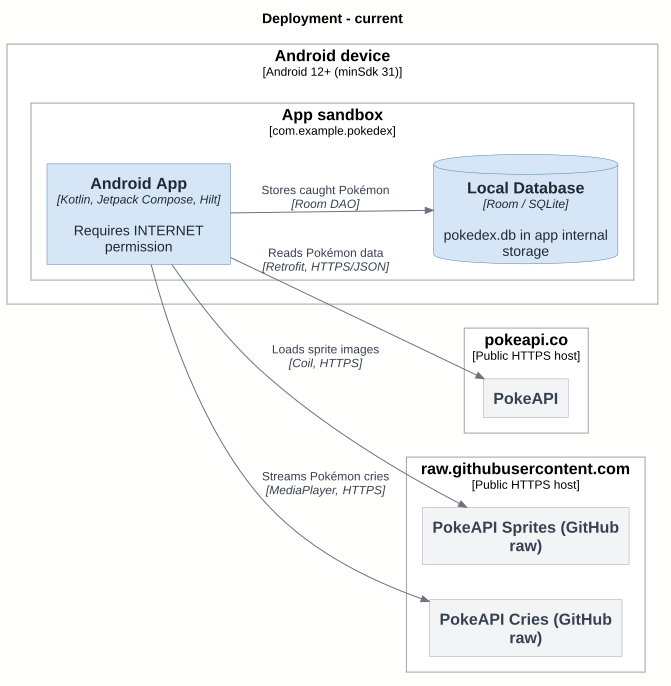

Source: [`04-deployment.puml`](c4/04-deployment.puml)

Where things run today: the app and `pokedex.db` on the phone, and two public HTTPS hosts. The app is installed as a local APK; it is not published yet.

### Deployment: planned

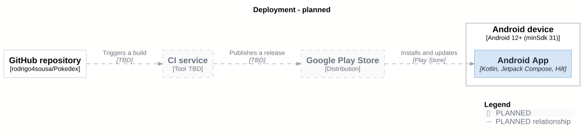

Source: [`04-deployment-planned.puml`](c4/04-deployment-planned.puml)

Planned only, so everything new is dashed: a CI service that builds the app from the GitHub repository and publishes it to the Play Store. No CI tool has been chosen yet, so the technology labels say TBD.

## 4+1 views

Sources in [`4plus1/`](4plus1/). Who each view is for, and which decision it documents, is in [`4plus1/README.md`](4plus1/README.md).

### Logical view: Pokédex catalog

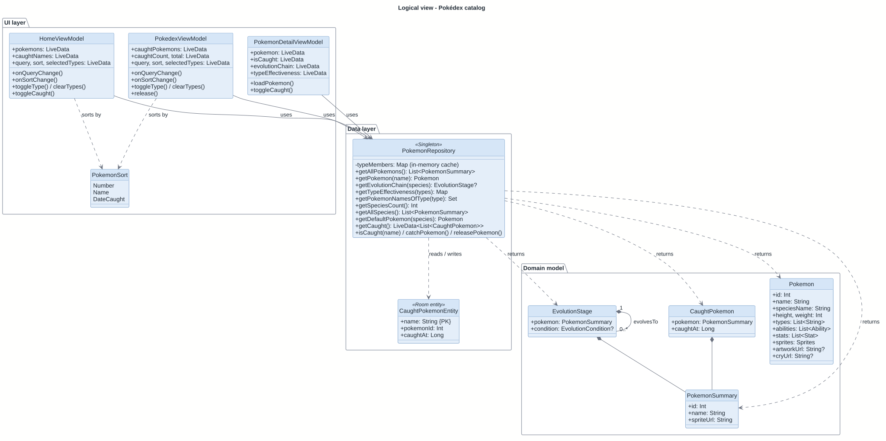

Source: [`logical-catalog.puml`](4plus1/logical-catalog.puml)

A UML class diagram grouped by layer, showing only public `LiveData` and actions. It documents MVVM with one ViewModel per screen and a single `PokemonRepository`, with no use-case layer. Arrows into the domain models show that PokeAPI's JSON shape and the Room entity stop at the repository.

### Logical view: guess game

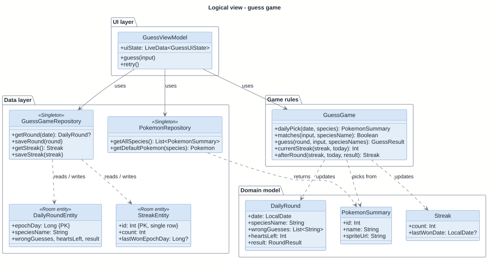

Source: [`logical-guess-game.puml`](4plus1/logical-guess-game.puml)

The game's classes. The rules (daily pick, name matching, hearts, streak) live in `GuessGame`, the saved state in `GuessGameRepository`, and `GuessViewModel` only connects them to `PokemonRepository` and the UI. The answer is a species name, so forms like `giratina-altered` don't break the matching.

### Process view: open Pokémon detail

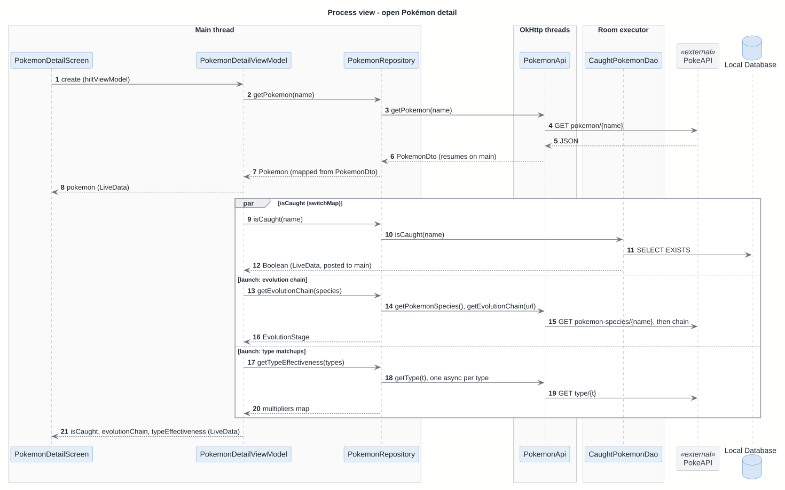

Source: [`process-open-pokemon-detail.puml`](4plus1/process-open-pokemon-detail.puml)

A sequence diagram that shows which thread does what. Everything starts in `viewModelScope` on the main thread; Retrofit's suspend calls run on OkHttp's threads, and Room's `LiveData` queries on Room's executor. The code sets no dispatchers of its own.

### Process view: caught state sync

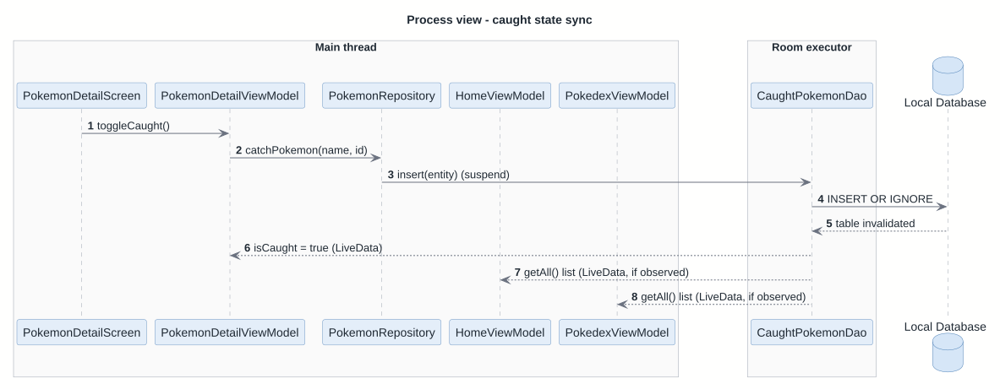

Source: [`process-caught-state-sync.puml`](4plus1/process-caught-state-sync.puml)

Room is the single source of truth for caught Pokémon. No screen tells another that something changed; every ViewModel observes Room, so a catch on the detail page shows up on Home and My Pokédex. A tab in the back stack refreshes when it becomes active again.

### Development view

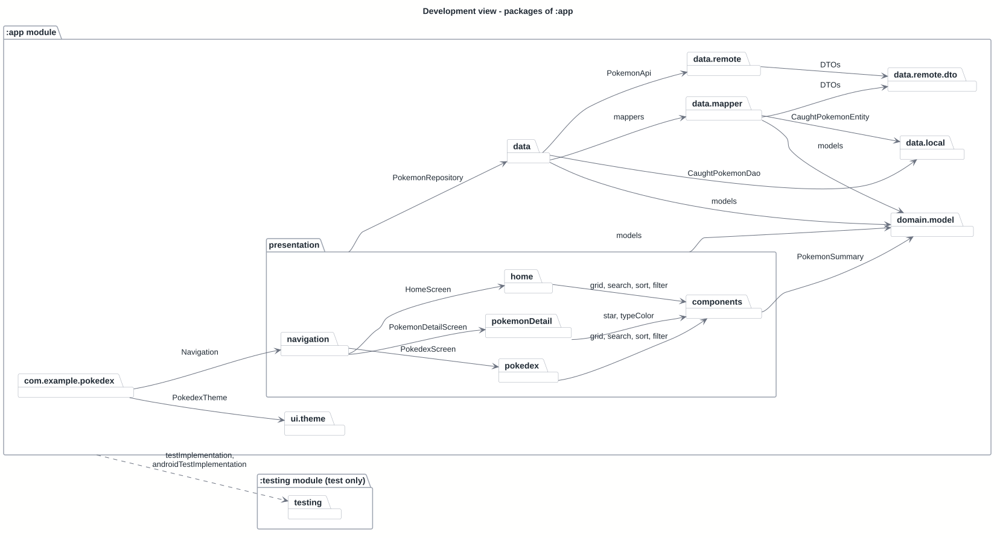

Source: [`development.puml`](4plus1/development.puml)

Packages as they are in the code, with arrows for imports. `presentation` depends only on the repositories and the domain packages; Retrofit and Room types stay inside `data`. The `:testing` module holds the fixtures shared by the JVM and device tests.

### Physical view

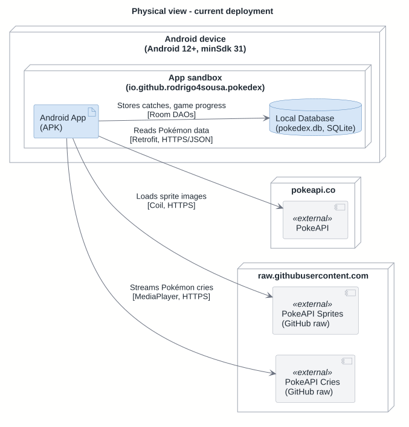

Source: [`physical.puml`](4plus1/physical.puml)

The same nodes as the C4 deployment diagram, in UML. It documents that everything runs on the device: the only remote dependencies are public HTTPS hosts, and the only persistent data is `pokedex.db` in the app sandbox.

### Scenarios: use cases

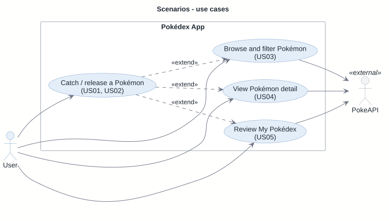

Source: [`scenarios-use-cases.puml`](4plus1/scenarios-use-cases.puml)

The "+1" view: the five use cases that drive the architecture and the external systems each one needs. Each use case maps to a user story in [`docs/specification.md`](../specification.md) and has its own sequence below.

### Scenario: browse and filter (US03)

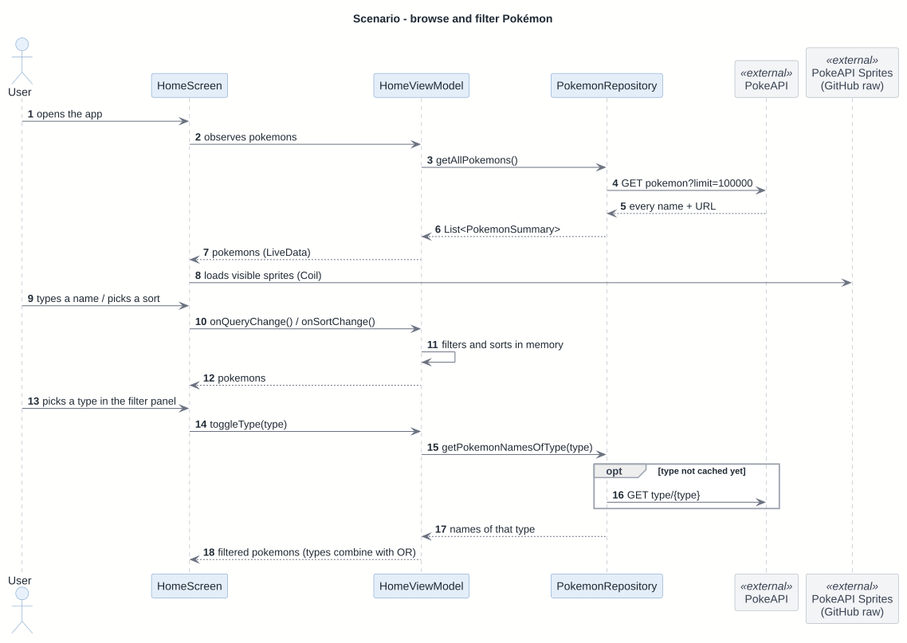

Source: [`scenarios-browse-and-filter.puml`](4plus1/scenarios-browse-and-filter.puml)

One network call loads the whole list; search, sort and filter then run in memory, and only the type filter needs one more call per type. Checked by `BrowseAndFilterSystemTest`.

### Scenario: catch / release (US01, US02)

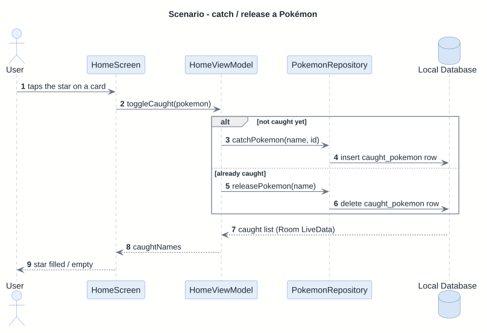

Source: [`scenarios-catch-release.puml`](4plus1/scenarios-catch-release.puml)

The two branches (catch, release) of the same tap, from the Home grid. My Pokédex and the detail page follow the same path. Checked by `CatchReleaseSystemTest`.

### Scenario: view detail (US04)

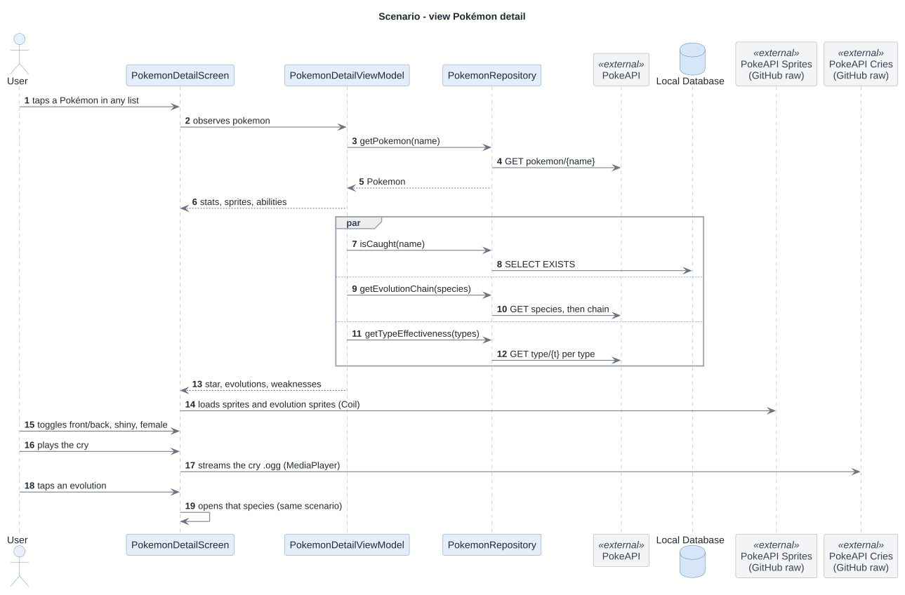

Source: [`scenarios-view-detail.puml`](4plus1/scenarios-view-detail.puml)

What the user sees on the detail page and where each part comes from, including the cry, which only plays when the user taps it. Checked by `ViewDetailSystemTest`.

### Scenario: My Pokédex (US05)

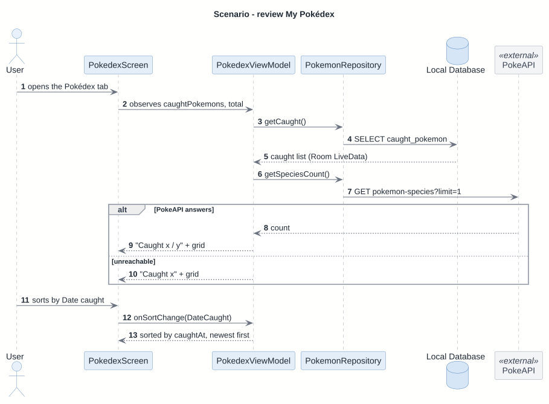

Source: [`scenarios-my-pokedex.puml`](4plus1/scenarios-my-pokedex.puml)

The caught list comes only from Room, so it works offline. PokeAPI is only asked for the "Caught x / 1025" total, which is optional. Checked by `MyPokedexSystemTest`.

### Scenario: guess the daily Pokémon (US06)

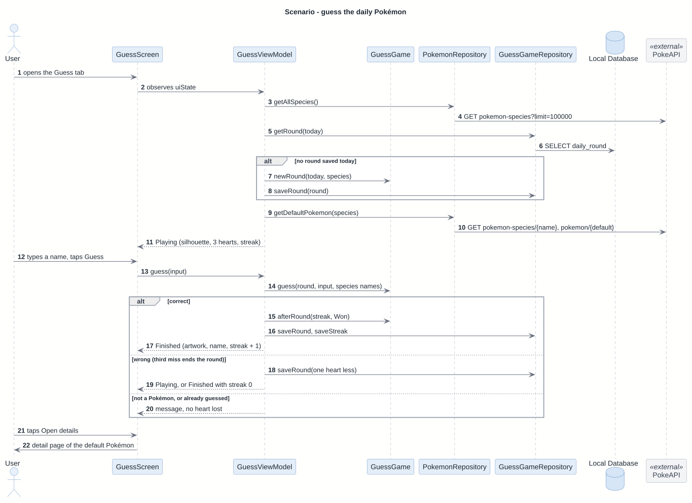

Source: [`scenarios-guess-pokemon.puml`](4plus1/scenarios-guess-pokemon.puml)

The first visit of the day picks a species and saves the round in Room, so the pick and the progress survive closing the app. Every guess is checked by `GuessGame`. Checked by `GuessPokemonSystemTest`.

## Guide

Sources in [`guide/`](guide/). Explanatory diagrams, not a C4 level or a 4+1 view; they use the same names and style as the others.

### MVVM

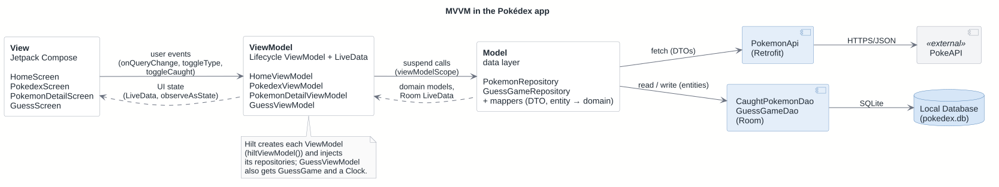

Source: [`mvvm.puml`](guide/mvvm.puml)

The three MVVM layers with the real classes in each. Read it top to bottom: user events go from the View to the ViewModel, suspend calls from the ViewModel to the repository, and the repository talks to PokeAPI through `PokemonApi` and to SQLite through the DAOs. Data comes back up as `LiveData`.

### Retrofit request

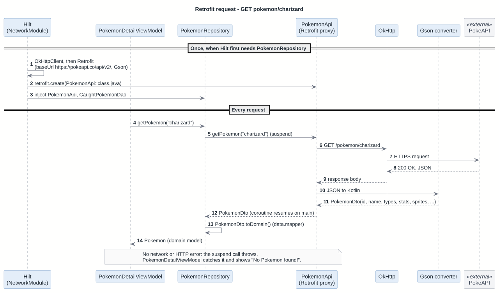

Source: [`retrofit-request.puml`](guide/retrofit-request.puml)

One request end to end, using Charizard's detail page. The top part runs once: Hilt builds `OkHttpClient` and `Retrofit` and creates `PokemonApi`. The rest runs per request: OkHttp sends `GET /pokemon/charizard`, Gson turns the JSON into DTOs, and the repository maps them to a `Pokemon`.

### Coil image loading

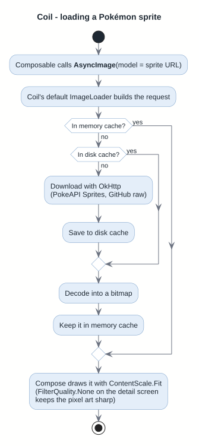

Source: [`coil-image-loading.puml`](guide/coil-image-loading.puml)

How a sprite reaches the screen with Coil's default settings: memory cache first, then disk cache, then a download from GitHub raw, then decode. This is why a sprite that was already shown appears at once, for example when the grid card's sprite flies into the detail page.

## Illustrations

The root [README](../../README.md#architecture) uses four hand-drawn SVGs in [`docs/images/architecture/`](../images/architecture/), modelled on the figures in Google's [Guide to app architecture](https://developer.android.com/topic/architecture). They are not generated from PlantUML; edit the SVG files directly.

| Illustration | Shows |
|---|---|
| [`overview.svg`](../images/architecture/overview.svg) | UI, domain (optional) and data layers, with events going down and state going up |
| [`ui-layer.svg`](../images/architecture/ui-layer.svg) | A screen sends events to its ViewModel and draws the UI state it gets back |
| [`data-layer.svg`](../images/architecture/data-layer.svg) | The two repositories, the mappers, and PokeAPI and Room as data sources |
| [`single-source-of-truth.svg`](../images/architecture/single-source-of-truth.svg) | A catch is written to Room, and Room updates every screen |

## Known limitations

The diagrams show the code as it is, gaps included.

Android Auto Backup is left out of the diagrams. `data_extraction_rules.xml` (Android 12+) and `backup_rules.xml` (Android 11 and lower, unused with `minSdk` 31) keep only `pokedex.db` and its WAL file, so caught Pokémon survive a phone change.

## Rendering the diagrams

The SVGs in [`out/`](out/) are generated from the `.puml` files; don't edit them by hand. [`render.sh`](render.sh) (Git Bash, macOS, Linux) and [`render.ps1`](render.ps1) (Windows PowerShell) render every diagram with the `plantuml/plantuml` Docker image. The diagrams use Arial and the image only has DejaVu fonts, so the scripts mount Arial from the host into the container. Docker must be running.

```bash
bash docs/architecture/render.sh
powershell -ExecutionPolicy Bypass -File docs\architecture\render.ps1
```

Docker is used only to render these diagrams. The app itself has no Docker setup and no CI yet.
